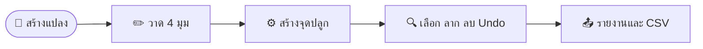
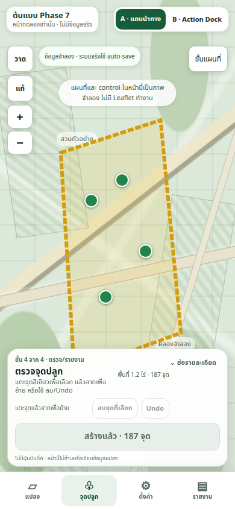
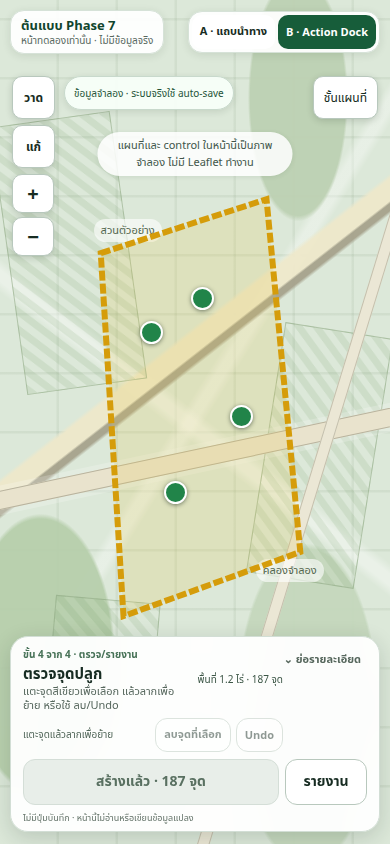
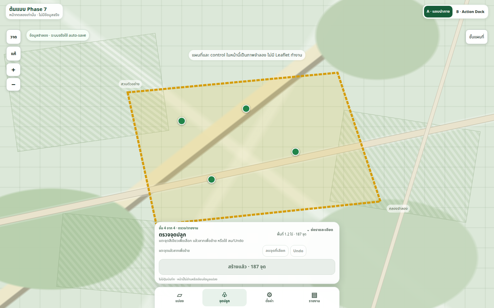
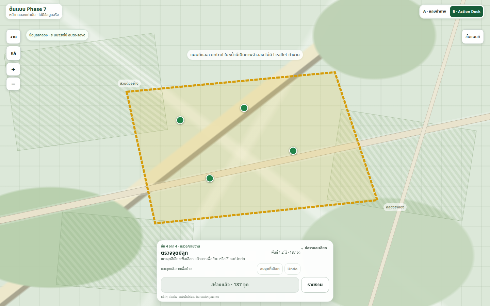

# Phase 7 — Prototype A/B: เปรียบเทียบ UX สำหรับมือถือ

_สวนปาล์ม V4 · สถานะ: ต้นแบบทดลองเท่านั้น · ตรวจด้วย Chromium บน Sandbox เมื่อ 24 ตุลาคม 2026_

---

## 🎯 สรุปผล

สร้างต้นแบบสองแนวทางใน `prototypes/phase-7/` โดยไม่แก้หน้า production, สูตรคำนวณ, handlers ของ Leaflet หรือ LocalStorage schema ทั้งสองหน้าใช้แผนที่ลายเส้นและข้อมูลสังเคราะห์ในหน่วยความจำ; ปุ่มส่งออกแสดงสถานะตัวอย่างแต่ไม่สร้างไฟล์จริง

| แนวทาง | รูปแบบ | จุดเด่นที่ตรวจพบ | สิ่งแลกเปลี่ยน |
| --- | --- | --- | --- |
| A | แถบนำทางหลัก 4 รายการ + แผงบริบทขนาดเล็ก | หมวด “แปลง / จุดปลูก / ตั้งค่า / รายงาน” มองเห็นตลอดและรู้ตำแหน่งปัจจุบัน | มีทั้งแผงบริบทและ navigation จึงใช้พื้นที่ล่างมากกว่า |
| B | แผนที่เป็นหลัก + Action Dock ตามสถานะ | เหลือพื้นที่แผนที่มากกว่าและไม่มีหมวดนำทางถาวร | รายงาน/ตั้งค่าต้องค้นจาก Dock; ต้องออกแบบสถานะและคำสั่งรองให้พบง่าย |

ผลนี้เป็นหลักฐานจาก prototype และ Chromium viewport simulation ไม่ใช่ผลทดสอบ usability กับผู้ใช้หรือ Android จริง จึงยังไม่เลือกแนวทางใดเพื่อนำไปใช้ production

## 🧭 ขอบเขตและวิธีเปิด

ต้นแบบอยู่ที่ [`prototypes/phase-7/index.html`](../prototypes/phase-7/index.html) และสลับ A/B ได้จากปุ่มด้านบน หากเปิดผ่าน local server ให้รันจากราก repository:

```bash
python3 -m http.server 8765 --directory prototypes/phase-7
```

จากนั้นเปิด `http://localhost:8765/`; ใช้ `?variant=b` เพื่อเปิด B โดยตรง และ `?demo=planted` เพื่อแสดงข้อมูลจุดปลูกสังเคราะห์สำหรับดูหน้าสรุป

ทั้งสอง variant ใช้ไฟล์ `prototype.js` และ `prototype.css` ของตนเองเท่านั้น ไม่ import `js/app.js`, ไม่เชื่อม Leaflet, ไม่อ่าน/เขียน browser storage และไม่เรียก network API ภาพ “วาด/แก้/ซูม/ชั้นแผนที่” เป็น mock control เพื่อบอกตำแหน่งเท่านั้น ส่วน marker เป็น DOM mock ที่รองรับการเลือกและ pointer drag เพื่อทดลอง affordance ไม่ใช่ marker layer จริง

_เส้นทาง A และ B ใช้สถานะจำลองชุดเดียวกัน: สร้างแปลง/วาดขอบเขต → สร้างจุดปลูก → เลือก/ลาก/ลบ/Undo → เปิดรายงานและส่งออกตัวอย่าง_



## 📸 ภาพหน้าจอและตัวอย่างการใช้งาน

ภาพเป็นหน้าจอ 390 × 844 CSS pixels ที่ viewport mode แสดงข้อมูลสังเคราะห์ 1.2 ไร่/187 จุด; ไม่ใช่ภาพจากโทรศัพท์จริง



*Figure 1: A — bottom navigation เป็นชุดเดียวร่วมกับแผงบริบท; ในงานรายงานใช้แท็บ “รายงาน” ไม่เพิ่มปุ่มนำทางซ้ำในแผง*



*Figure 2: B — แผนที่เป็นพื้นที่หลัก; Action Dock แสดงสรุปและปุ่มรายงานตาม state*

ภาพ desktop ใช้เปรียบเทียบการจัดวางเมื่อมีพื้นที่กว้าง ไม่ใช่ข้อสรุปแทนผลบนมือถือ



*Figure 3: A บน desktop — navigation และแผงบริบทอยู่กึ่งกลางขอบล่างของ map*



*Figure 4: B บน desktop — Action Dock อยู่กึ่งกลางและไม่มีแถบนำทางถาวร*

## 📊 จำนวนแตะและการสลับหมวด

จำนวนด้านล่างนับตาม interaction ที่ออกแบบและทดสอบใน prototype; “แตะ” เป็นการกด control หนึ่งครั้ง ส่วนการลากนับเป็น gesture แยกต่างหาก การวาดนับ 4 แตะบนพื้นที่จำลองเพื่อวางมุม polygon และหนึ่งแตะปิดขอบเขต

| งาน | A: แตะ/gesture | A: การเปลี่ยนหมวด | B: แตะ/gesture | B: การเปลี่ยนหมวด |
| --- | --- | --- | --- | --- |
| A. สร้างแปลงและวาดขอบเขต | 6 แตะ: สร้างแปลง+เริ่มวาด 1, วางมุม 4, ปิดขอบเขต 1 | 0 โดยผู้ใช้ | 6 แตะ เช่นเดียวกับ A | 0 |
| B. สร้างจุดปลูกและดูสรุป | 1 แตะ: สร้างจุด | ไม่มีแตะเพื่อเปลี่ยน; ระบบเลื่อนไป “จุดปลูก” อัตโนมัติ 1 ครั้ง | 1 แตะ: สร้างจุด | 0; Dock เปลี่ยนเนื้อหาตาม state |
| C. เลือก ลาก ลบ และ Undo | 3 แตะ + 1 drag: เลือก 1, ลบ 1, Undo 1 | 0; อยู่ใน “จุดปลูก” ต่อ | 3 แตะ + 1 drag | 0 |
| D. เปิดรายงานและส่งออก | 2 แตะ: เปิด “รายงาน” 1, ส่งออก CSV ตัวอย่าง 1 | 1 ครั้ง | 2 แตะ: เปิดรายงานจาก Dock 1, ส่งออก CSV ตัวอย่าง 1 | 0 หมวด; มีการเปลี่ยน panel เป็นรายงาน 1 ครั้ง |

ตัวนับเป็น flow ของหน้าต้นแบบ ไม่รวม browser chrome, การเปิดลิงก์ต้นแบบ หรือการแตะที่ระบบจริงอาจเพิ่ม (เช่น ตั้งชื่อแปลงหรือยืนยันการแทนที่กริด) ซึ่งไม่ได้จำลองครบ ใน A การเปลี่ยนหลังสร้างกริดเป็นการเปลี่ยนปลายทางอัตโนมัติ ไม่ใช่การแตะของผู้ใช้; ใน B การเปิดรายงานเป็นการเปลี่ยน panel แต่ไม่มี navigation category

## 🗺️ พื้นที่แผนที่และความเสี่ยงต่อ controls

วัด bounding boxes ของ bottom panel/Dock และ navigation ใน Chromium; สัดส่วนคือพื้นที่ของ overlay ด้านล่าง ÷ พื้นที่ viewport รวม ไม่หักพื้นที่ header, status chip หรือ mock controls จึงเป็นค่าประมาณการพื้นที่ที่ UI ด้านล่างบัง ไม่ใช่พื้นที่ว่างจริงแบบสำรวจพิกเซล

| Viewport | A: พื้นที่ overlay ด้านล่าง | B: พื้นที่ overlay ด้านล่าง | ผล geometry |
| --- | ---: | ---: | --- |
| 320 × 800 | ≈ 28.9% | ≈ 26.7% | ไม่มี overflow; controls ไม่ชน panel/Dock |
| 360 × 800 | ≈ 29.0% | ≈ 20.8% | ไม่มี overflow; controls ไม่ชน panel/Dock |
| 390 × 844 | ≈ 29.2% | ≈ 22.1% | ไม่มี overflow; controls ไม่ชน panel/Dock |
| 844 × 390 แนวนอน | ≈ 30.0% | ≈ 20.0% | ไม่มี overflow; dock/panel อยู่ใน viewport |
| 1440 × 900 desktop | ≈ 10.2% | ≈ 7.3% | ไม่มี overflow; Dock A/B ไม่ล้นขอบ |

บน 390 × 844 ค่าจาก panel/nav ที่วัดได้คือ A: panel 366 × 196 CSS px และ nav 390 × 62; B: Dock 370 × 196 CSS px ไม่มี nav แยก ที่ 320 × 800 Dock B สูงขึ้นเป็นประมาณ 228 px เพราะข้อความ/ปุ่มห่อบรรทัด จึงได้สัดส่วนใกล้ A มากขึ้น

ตำแหน่ง mock controls ถูกวางมุมบนซ้าย/ขวา ขณะที่ panel/Dock อยู่ล่าง; ใน viewport ทั้ง 10 คู่ (5 ขนาด × 2 variants) ไม่พบ geometry intersection ระหว่าง controls ด้านบนกับ panel/Dock, overflow, หรือ element หลักหลุดขอบ การตรวจนี้ไม่ยืนยันความปลอดภัยกับ Leaflet controls จริง: controls ในต้นแบบไม่รับ input และการวาด, zoom, layers, map pan/pinch จริงไม่ได้ทำงาน

## ⚖️ ข้อดี ข้อเสีย และต้นทุนโดยประมาณ

| ด้าน | A — navigation + context panel | B — map + Action Dock |
| --- | --- | --- |
| การค้นหาฟีเจอร์ | ปลายทางหลักมองเห็นตลอด; เหมาะกับผู้ใช้ที่คิดเป็นหมวด | ใช้พื้นที่น้อยกว่า; ผู้ใช้ต้องเข้าใจว่าคำสั่งเปลี่ยนตามสถานะ |
| งานต่อเนื่อง A–C | แผงบอกบริบท; หลังสร้างกริดสลับไปจุดปลูกโดยอัตโนมัติ | อยู่บน map และ Dock เดิมตลอด ไม่ต้องสลับหมวด |
| งานรายงาน D | แตะหมวดรายงานแล้วส่งออก; มี mental model แบบ navigation ชัด | ปุ่มรายงานอยู่ใน Dock แล้วเปลี่ยน panel; ต้องรักษาความชัดของปุ่มรอง |
| พื้นที่ map | ใช้พื้นที่เพิ่มจาก nav และ panel พร้อมกัน | เหลือพื้นที่มากกว่าใน viewport ที่วัด โดยเฉพาะ 360–390 px |
| ความเสี่ยง UX | nav 4 รายการต้องแทน/จัดกลุ่ม 6 หมวดเดิมให้เข้าใจ และต้องไม่ซ้ำกับแผง | รายงาน/ตั้งค่าอาจค้นพบยาก; primary action ที่เปลี่ยนไปอาจทำให้ตำแหน่งการกระทำไม่คงที่ |
| ต้นทุนพัฒนาโดยคร่าว | ปานกลาง: mapping หมวดเดิม, active state, safe-area และการคง selection | ปานกลางถึงสูง: state-based action hierarchy, discoverability ของคำสั่งรอง, drag/map-control coexistence และ accessibility |

ระดับต้นทุนเป็นการประเมินเชิงเปรียบเทียบ ณ ระยะ prototype ไม่ใช่ effort estimate หรือข้อสรุปเรื่องค่าใช้จ่าย ก่อนเลือกควรทำ usability test กับผู้ปลูก/ผู้ใช้งานเป้าหมาย โดยเฉพาะผู้ใช้ที่ไม่คุ้นกับแผนที่ดิจิทัล

## 🧪 สิ่งที่ทดสอบแล้วและข้อจำกัด

**ทดสอบแล้วใน Sandbox:**

- `node --test tests/regression.test.cjs tests/phase-7-prototypes.test.cjs` — 12 tests ผ่าน, 0 ล้มเหลว
- `node --check js/app.js`, `node --check js/calculator.js`, `node --check js/exporter.js`, `node --check prototypes/phase-7/prototype.js` — ผ่าน
- `git diff --check` — ผ่าน; `git diff --exit-code HEAD -- index.html css/style.css js/app.js js/calculator.js js/exporter.js` — ไม่มี diff ในไฟล์ production เหล่านี้
- Chromium headless ด้วย viewport emulation: A และ B ที่ 320×800, 360×800, 390×844, 844×390 แนวนอน และ 1440×900 — ไม่พบ horizontal/vertical overflow, off-screen primary panel หรือ bottom panel/Dock ชน mock controls
- DOM-driven interaction flow A–D ทั้งสองแนวทาง: สร้างขอบเขตสังเคราะห์, สร้าง 187 จุด, เลือกและลาก marker ด้วย `pointerdown/move/up`, ลบแล้วได้ 186, Undo กลับเป็น 187, เปิดรายงานและ export action นับได้หนึ่งครั้ง; ย่อรายละเอียดแล้วยังเห็น primary action และ status

**ยังไม่ได้ทดสอบ:**

- Android จริง, Chrome/Android WebView จริง, การหมุนอุปกรณ์จริง, safe area/cutout/gesture navigation จริง และ TalkBack
- Leaflet draw/edit/zoom/layers, การแพน/ซูมแบบ pinch, marker drag กับ layer จริง, warning/Undo ของระบบ production
- การบันทึก draft, LocalStorage, การ export ไฟล์ CSV จริง หรือพฤติกรรม production อื่น ๆ
- การวัด task completion time, error rate หรือความพึงพอใจจากผู้ใช้จริง

ดังนั้นผลนี้ยืนยันเฉพาะต้นแบบแยกและ geometry ใน headless Chromium; **ไม่ใช่การทดสอบ Android และไม่ใช่การตรวจรับ production UI**

## 📱 รายการทดสอบก่อนตัดสินใจบน Android จริง

- [ ] เปิด prototype บนเครื่องจริงและตรวจความกว้าง CSS 320/360/390 โดยบันทึกรุ่นอุปกรณ์, OS, browser และขนาด font
- [ ] ตรวจแนวตั้ง/แนวนอน รวม status/navigation bar, cutout, safe-area inset, gesture-navigation edge และการเปลี่ยน orientation ระหว่างมี selection
- [ ] ใช้นิ้วแตะ/ลาก marker หลายตำแหน่งจริง วัดความแม่นยำ, accidental map pan, การยึด pointer ระหว่างลาก และการกลับสถานะหลัง `pointercancel`
- [ ] บน build ที่มี Leaflet จริง ตรวจวาด/ปิด polygon, edit handles, zoom, layers และการลากแผนที่/pinch ว่า panel หรือ Dock ไม่บัง control/จุดที่ต้องแตะ
- [ ] ตรวจเป้าหมายสัมผัสอย่างน้อย 44 × 44 CSS px, thumb reachability, การตัดบรรทัด, ข้อความขนาดใหญ่/zoom และแป้นพิมพ์
- [ ] ใช้ TalkBack ตรวจชื่อปุ่ม, ลำดับโฟกัส, สถานะ active/disabled, live announcements, การย่อ/ขยาย panel และการเลือก/ลากแบบ keyboard/screen-reader alternative
- [ ] ทดสอบว่าการสลับหมวด/ย่อ panel ไม่ทำให้ selection, marker position, draft หรือ Undo history สูญหายบนระบบจริง
- [ ] ยืนยันข้อความ auto-save ที่ถูกต้องกับพฤติกรรมจริง และไม่มีปุ่ม “บันทึก” ซ้ำหรือข้อความที่ทำให้เข้าใจผิด
- [ ] ทดสอบบนสวนขนาดเล็กและใหญ่ มี marker หนาแน่น, ชื่อแปลงยาว, ข้อความ locale/ตัวเลข และสถานะที่ไม่มี boundary/ไม่มีต้น/มีจุดถูกลบ
- [ ] ให้ผู้ใช้เป้าหมายทำงาน A–D โดยไม่บอกตำแหน่งปุ่ม; บันทึกจำนวนแตะ/gesture, การสลับหมวด, ข้อผิดพลาด และเหตุผลที่ติดขัดสำหรับ A เทียบ B

## 🧾 ไฟล์และ Git status

ไฟล์ที่สร้างหรือแก้ใน Phase 7:

- `prototypes/phase-7/index.html` — หน้าต้นแบบแยกสำหรับ A/B
- `prototypes/phase-7/prototype.css` — responsive layout, mock map controls และสองรูปแบบ bottom UI
- `prototypes/phase-7/prototype.js` — state จำลองในหน่วยความจำและ pointer drag ของ marker
- `tests/phase-7-prototypes.test.cjs` — regression tests สำหรับ isolation, flow, responsive affordances และ gesture hooks
- `docs/PHASE-7-PROTOTYPE-COMPARISON.md` — ผลเปรียบเทียบ/ข้อจำกัด/รายการ Android test
- `docs/images/phase-7-prototype-A.png`, `docs/images/phase-7-prototype-B.png` — screenshots แนวตั้ง 390 × 844
- `docs/images/phase-7-prototype-A-desktop.png`, `docs/images/phase-7-prototype-B-desktop.png` — screenshots desktop 1440 × 900

`index.html`, `css/style.css`, `js/app.js`, `js/calculator.js` และ `js/exporter.js` ไม่มี diff จาก `HEAD` ในงานนี้ ยังคงต้อง review prototype และผล Android test ก่อนเลือกแบบ
