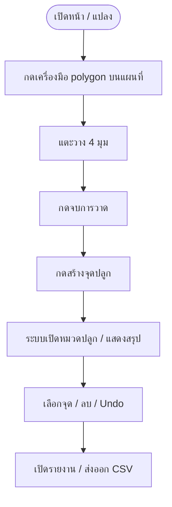

# UX Audit — สวนปาล์ม V4 (Phase 6)

_ตรวจบน commit `c789810` · `aodxx/suan-palm` · 2026-10-23 · ขอบเขต: audit และเอกสารเท่านั้น_

---

## 📋 สรุปสำหรับตัดสินใจ

- โค้ดปัจจุบันมีหมวดเครื่องมือ 6 หมวดและแผงบริบทชุดเดียว; ปุ่มสร้างจุดปลูกอยู่ก่อนแถบหมวด และหลังสร้างจะเปิดหมวดปลูกปาล์มให้อัตโนมัติ จึงไม่ต้องสลับหมวดในงาน B
- Desktop smoke test ผ่านงานวาด polygon → สร้าง 187 จุด → ลบหนึ่งจุด → Undo กลับเป็น 187 → export CSV สำเร็จ โดยใช้ข้อมูลสังเคราะห์และคลิกบน UI จริง
- ความเสี่ยงที่ควรทำต้นแบบใน Phase 7 คือเมื่อย่อ bottom sheet จะซ่อนทั้งปุ่มหลัก สถานะ และเครื่องมือทั้งหมด; และเมื่อสร้าง/แก้/ลบ polygon ระบบล้าง grid เดิมโดยไม่มี confirmation ใน handler เหล่านั้น
- Test suite ผ่าน 7/7 และ syntax checks ผ่าน 3 ไฟล์ แต่ไม่ได้พิสูจน์ touch UX, GPS, restore หลัง refresh หรือการดาวน์โหลดทุกชนิดบน Android
- ยังไม่แก้ UI หรือฟังก์ชันใด; เอกสารนี้เป็น baseline เพื่อออกแบบและทดสอบ Phase 7–10 ต่อไป

## 🧭 เวอร์ชันและวิธีตรวจ

### เวอร์ชันและขอบเขต

ตรวจ repository `aodxx/suan-palm` ที่ commit `c789810` บน `main` ก่อนสร้างสาขาเอกสาร `docs/phase-6-ux-audit` ตรวจทั้งโค้ดและหน้า [GitHub Pages ของโครงการ][live-site] โดยไม่มีการแก้ไฟล์แอป, สูตร, event handlers หรือ LocalStorage schema ใน Phase 6 นี้

ไฟล์แนบที่เข้าถึงได้ใน session นี้มี `pasted_content.txt` ซึ่งเป็นโจทย์ข้อความ ไม่พบไฟล์ภาพหน้าจอตัวอย่าง จึงใช้หลักการที่บันทึกไว้ใน Roadmap (map-first, คำสั่งใกล้มือ, ไม่เพิ่ม navigation ซ้ำ) เป็นข้อกำหนดเชิงข้อความ ไม่อ้างว่าตรวจเทียบภาพต้นฉบับแล้ว

### วิธีตรวจและขอบเขตความเชื่อมั่น

| ชั้นหลักฐาน | สิ่งที่ทำ | ข้อสรุปที่ใช้ได้ |
|---|---|---|
| Code review | อ่าน `index.html`, `css/style.css`, `js/app.js`, `js/calculator.js`, `js/exporter.js`, regression tests, README และ Roadmap | ยืนยันตำแหน่ง controls, handlers, state, CSS breakpoints และ coverage ตาม source ที่ระบุด้านล่าง |
| Browser desktop | Chrome ใน Sandbox, viewport 1280×1100; สลับครบ 6 หมวด, วาด polygon 4 มุมผ่าน Leaflet.draw, สร้างกริด, เลือก/ลบ marker, Undo และกด export CSV | ยืนยัน interaction บน browser desktop ด้วยข้อมูลสังเคราะห์เท่านั้น ไม่ใช่ Android จริง |
| Automated | `node --test` และ `node --check` บน `c789810` | ยืนยันเฉพาะ assertions ที่มีในชุดทดสอบ ไม่ได้พิสูจน์ usability หรือการทำงานของ browser API ทุกชนิด |
| Android จริง | ไม่มีอุปกรณ์ Android ให้ทดสอบในรอบนี้ | ทุกข้อเกี่ยวกับ touch, safe area, rotation, GPS permission และการดาวน์โหลดบน Android ยังเป็น pending |

หลัง smoke test ลบเฉพาะ draft ที่สร้างในการทดสอบออกจาก LocalStorage ของ Sandbox, ลบไฟล์ `palm-plan.csv` ที่ดาวน์โหลดจาก test และ reload หน้า ตรวจยืนยันว่า LocalStorage ว่างและกลับสู่หน้าเริ่มต้นแล้ว ไม่มีการส่งข้อมูลแปลงจริงไป backend

## 🗺️ โครงสร้าง UI ที่พบจากโค้ดจริง

| ส่วน | พฤติกรรมจริง | หลักฐาน |
|---|---|---|
| พื้นที่ทำงาน | แผนที่ Leaflet เป็น element แยกจาก sidebar; บน Desktop อยู่ข้างแผงเครื่องมือ ส่วนจอไม่เกิน 720px แผนที่เต็ม viewport และ sidebar กลายเป็น bottom sheet | [`index.html` map/sidebar](../index.html#L23-L29), [`style.css` layout](../css/style.css#L7-L11) และ [mobile breakpoint](../css/style.css#L91-L118) |
| Workflow และ CTA | มี progress 5 ขั้น; ปุ่ม “สร้างจุดปลูกปาล์ม” อยู่เหนือหมวดและเริ่ม disabled จนมี polygon; หลังสร้างจะแสดงข้อมูลสรุปในหมวดปลูกปาล์ม | [`index.html`](../index.html#L34-L59), [`app.js`](../js/app.js#L561-L580) |
| 6 หมวด | แปลง: ชื่อ/จุดกึ่งกลาง/พื้นที่; วาด/แก้ไข: คำแนะนำ โดยเครื่องมือจริงอยู่บนแผนที่; ปลูกปาล์ม: สรุป/ตรวจ/Undo; ตั้งค่า: spacing, rotation, margin, ราคาต้นกล้า; รายงาน: PDF/Print/CSV/GeoJSON; เพิ่มเติม: GPS, วิธีใช้, privacy และ Clear all | [`index.html`](../index.html#L52-L59), panels [`index.html`](../index.html#L61-L104) |
| Map controls และ markers | Leaflet.draw อยู่บนแผนที่ตลอด ไม่จำเป็นต้องเปิดหมวดวาดก่อน; แตะ marker เปิด popup ลบ, คลิกขวาลบ, drag เพื่อย้าย และมี near-distance warning/Undo | [`app.js`](../js/app.js#L854-L863); คำอธิบาย marker ใน [`index.html`](../index.html#L77-L82) |
| Bottom sheet | Mobile สูงเริ่มได้ถึง `min(76dvh, 690px)`; สถานะย่อเหลือ `62px + safe-area`; สถานะย่อ/ขยายบันทึกใน `suan-palm-sheet-collapsed` และคืนค่าบน mobile | [`style.css`](../css/style.css#L91-L118), [`app.js`](../js/app.js#L352-L370), [`app.js`](../js/app.js#L788-L798) |
| Persistence | Draft v1 ใช้ `suan-palm-draft-v1`; auto-save ชื่อ, settings, feature/ตำแหน่ง และ tree markers; restore อ่าน version 1 เมื่อเริ่มแอป; footer สื่อสถานะ save/storage | [`app.js`](../js/app.js#L352-L417), [`app.js`](../js/app.js#L438-L455), [`index.html`](../index.html#L107-L110) |
| การส่งออก | CSV/GeoJSON ต้องมีจุดปลูก; PDF/Print ต้องมีทั้งจุดปลูกและชื่อแปลง; เงื่อนไขแสดงผ่าน `title` บนปุ่ม disabled | [`app.js`](../js/app.js#L535-L559), [`index.html`](../index.html#L93-L98), [`exporter.js`](../js/exporter.js#L70-L110) |
| ไอคอน | regression ตรวจ SVG path/viewBox; production browser พบภาพ SVG ใน `` ครบสถานะ `complete` และมี `naturalWidth > 0` ใน viewport ที่ตรวจ | [`tests/regression.test.cjs`](../tests/regression.test.cjs#L46-L54); assets อยู่ใน `assets/icons/ui-3d/` |

### Flow ปัจจุบันที่ใช้วัด baseline

แผนภาพนี้เป็น flow ที่ browser test เดินจริงสำหรับพื้นที่สังเคราะห์; บนมือถือยังต้องตรวจจำนวน gesture และการยุบ/ขยายแผงแยกต่างหาก

## 🔢 Workflow A–D และจำนวนแตะ/คลิก

จำนวนด้านล่างนับ interaction แยกที่ผู้ใช้ต้องเริ่มเอง ไม่รวมเวลาพิมพ์ข้อความ, การลาก marker เป็น gesture ต่อเนื่อง, การรอโหลด tile และการปรับซูมหรือ pan เพื่อให้เข้าถึงแปลง โดยใช้สมมติฐานว่าเริ่มจากหน้า Plot ที่ว่างและยังไม่มีกริด/จุดเดิม

| งาน | ลำดับปัจจุบันและผลจริง | แตะ/คลิกโดยประมาณ | สลับหมวด / เปิด-ย่อแผง | จุดติดขัดและแนวปรับปรุง |
|---|---|---:|---|---|
| **A — เริ่มแปลงและวาดขอบเขต** | บนหน้าเริ่มต้นกด Draw polygon ที่มุมแผนที่ → วาง 4 มุม → กด ✓ จบ polygon. ใน browser test ทำครบด้วย mouse click; ไม่จำเป็นต้องกดหมวด “วาด/แก้ไข” ก่อน | **6** ขั้นต่ำ: เครื่องมือ 1 + มุม 4 + จบ 1. ถ้ากดหมวด “วาด/แก้ไข” เพื่ออ่านคำแนะนำก่อน เพิ่มเป็น **7**. ตั้งชื่อแปลงเป็นทางเลือกสำหรับการวาด/สร้างกริด แต่จำเป็นสำหรับ PDF/Print | ขั้นต่ำ **0** หมวด; เปิดหมวดคำแนะนำ **1** ครั้ง; Desktop panel คงที่ **0** เปิด/ย่อ. บนมือถือยังวัดไม่ได้ | ไม่มีปุ่ม “แผนใหม่” แยกจากแผนที่บันทึกไว้; polygon ใหม่แทน polygon เดิมและ handler ล้าง grid. ถ้ามี draft เดิม ควรแจ้งผลกระทบก่อนเริ่มพื้นที่ใหม่; ทางเลือก Clear all อยู่ใน “เพิ่มเติม” และมี confirm (เส้นทางนี้ตรวจจากโค้ด/README ไม่ได้นับใน browser test) |
| **B — สร้างจุดปลูก** | เมื่อมี polygon ปุ่มหลักเปิดใช้งาน; กดครั้งเดียว; ระบบสร้างจุดและเปิดหมวด “ปลูกปาล์ม” พร้อมค่าประมาณ/ค่าจริง/ความหนาแน่น/ระยะแถว. Test ได้ **187 จุดจริง** | **1** | สลับหมวดเอง **0**; auto-switch ไป Plant **1 ครั้งโดยระบบ**; Desktop panel open/collapse **0**. บน mobile ถ้าผู้ใช้ย่อ panel เอง ปุ่มสร้างถูกซ่อนไปและต้องเปิด panel อีกครั้ง | จุดแข็งคือไม่ต้องเปิดแท็บหลังวาด; จุดอ่อนคือ CTA และ feedback หายเมื่อ sheet ถูกย่อ (ดู Finding P1-1). แสดงพื้นที่และบอกว่าการสร้างใหม่จะแทนที่จุดที่ปรับแล้วก่อนกด |
| **C — ตรวจและแก้จุดปลูก** | แตะ marker → popup “ลบต้นนี้” → กด Undo เพื่อคืน. Test ทำจริงจาก 187 → 186 → 187; การลากต้องกด/ลาก marker และปล่อย; ข้อความสีแดงเตือนระยะมีคำอธิบายใน panel | **3** สำหรับเลือก/ลบ/Undo; เพิ่ม **1 gesture** สำหรับลากจุด (ไม่รวมระยะลาก) | สลับหมวด **0**; เปิด/ย่อ panel **0** ใน Desktop flow. บน mobile ต้องตรวจว่า sheet ไม่บังเป้าหมายและ popup กดได้ด้วยนิ้ว | การแตะ marker เปิด popup อีกขั้นก่อนลบ แต่ช่วยป้องกันลบโดยพลาด; ข้อความบอกสีแดง/drag/Undo มีอยู่แล้ว. ทดสอบบนจอจริงเรื่อง target size และ popup placement; อย่าลบขั้นยืนยันโดยไม่มีผลทดสอบ |
| **D — ดูสรุปและส่งออก** | หลัง B ระบบเปิด Plant และแสดงสรุปทันที; กด Report → CSV หรือ GeoJSON. Test กด CSV และเห็นสถานะ “ส่งออก CSV แล้ว · 187 จุด” | **2** เมื่อใช้ CSV/GeoJSON (Report 1 + export 1), โดยสรุปเห็นจาก auto-switch แล้ว | สลับหมวดเอง **1** ครั้ง; Desktop panel open/collapse **0** | PDF/Print ต้องมีชื่อแปลงและจุดปลูก. ถ้ายังไม่กรอกชื่อ ต้องไป Plot → กรอกชื่อ → Report → PDF/Print (อย่างน้อย 4 taps เพิ่มจากจุดเริ่มที่ Plant; ไม่นับตัวอักษร). ปัจจุบันเหตุผล disabled อยู่ใน `title` ซึ่งไม่เพียงพอสำหรับผู้ใช้ touch ที่ไม่มี hover; ควรแสดงเหตุผลค้างบนจอ/เชื่อม `aria-describedby` |

> **ถ้ามีแผนที่บันทึกไว้และต้องการล้างก่อนเริ่มใหม่:** “เพิ่มเติม” → “ล้างข้อมูลแผนทั้งหมด” → confirm คือ 3 interaction เพิ่มจากเส้นทาง A; นี่เป็นเส้นทาง Clear all ตามโค้ด/คู่มือ ไม่ได้กดจริงในการ smoke test รอบนี้. ระบบยัง auto-save ลงอุปกรณ์เดิม ไม่ใช่ cloud backup

## 🧪 ผลทดสอบและ coverage

### ผลที่รันจริง

| การตรวจ | ผล | หมายเหตุ |
|---|---|---|
| `node --test tests/regression.test.cjs` | **ผ่าน 7, ไม่ผ่าน 0** | ตรวจ IDs, tabs/panels/ชื่อไทย, คำอธิบาย disabled, SVG/viewBox, responsive/accessibility affordances, baseline สูตร และ class ไอคอน/ซ่อน panel |
| `node --check js/app.js` | **ผ่าน** | exit code 0 |
| `node --check js/calculator.js` | **ผ่าน** | exit code 0 |
| `node --check js/exporter.js` | **ผ่าน** | exit code 0 |
| Browser desktop: สลับหมวดทั้ง 6 | **ผ่าน** | panel เปลี่ยน, แผนที่ยังอยู่; viewport 1280×1100 ไม่มี horizontal overflow |
| Browser desktop: SVG ที่ใช้บนหน้าเริ่มต้น | **ผ่าน** | `` SVG ที่ตรวจโหลดครบ (`complete`, `naturalWidth > 0`); ไม่ใช่การตรวจทุก route/state หรือทุกเครือข่าย |
| Browser desktop: polygon → grid → delete → Undo | **ผ่าน** | Leaflet.draw ผ่าน control และ 4 มุม; สร้าง 187 จุด; ลบเหลือ 186; Undo คืน 187 |
| Browser desktop: CSV | **ผ่าน** | app status แจ้งสำเร็จและ 187 จุด; ไฟล์ทดสอบถูกลบหลังตรวจ |
| Console/network | **จำกัด** | ไม่มี JavaScript error ที่เห็นใน console snapshot หลัง reload; ไม่ได้ทำ network/HAR audit เต็มรูปแบบหรือยืนยัน status ของ external tile/CDN ทุกคำขอ |
| Android/GPS/rotation/safe-area | **ยังไม่ได้ทดสอบ** | ไม่มี Android จริงในสภาพแวดล้อมนี้ |

### สิ่งที่ automated tests ครอบคลุมและยังขาด

ชุดทดสอบมี 7 cases ตาม [`tests/regression.test.cjs`](../tests/regression.test.cjs#L21-L84): รักษา element IDs, ความสัมพันธ์แท็บ/panel และ label ไทย, prerequisite ของปุ่ม disabled, ไอคอน SVG/viewBox, CSS responsive/accessibility flags, ค่าฐานสูตรคำนวณและช่วงระยะ, และ shared icon class/hidden panel

ยังไม่มี automated coverage ที่พิสูจน์ Leaflet draw/edit/delete จาก mouse/touch, การยุบ/ขยาย sheet จริง, การย้าย marker และ near-distance warning, การลบ/Undo บนจอสัมผัส, LocalStorage round-trip หลัง refresh หรือกรณี storage ถูกปิดกั้น, GPS grant/deny, และเนื้อหาไฟล์ PDF/Print/CSV/GeoJSON ที่ดาวน์โหลด. Desktop smoke test รอบนี้ช่วยยืนยันเส้นทางสร้าง/ลบ/Undo/CSV แต่ไม่ทดแทน test ที่ทำซ้ำได้หรือ Android acceptance

## 🔍 ข้อค้นพบเรียงตามความสำคัญ

| ID / ความสำคัญ | ปัญหาและหลักฐาน | ผลกระทบต่อผู้ใช้มือใหม่ | แนวทางแก้ที่เสนอ | เกณฑ์พิสูจน์ว่าดีขึ้น |
|---|---|---|---|---|
| **P1-1 — คำสั่งสำคัญหายเมื่อย่อแผง** | Mobile CSS ซ่อน `#sidebarContent` ทั้งหมดเมื่อ `#sidebar.is-collapsed`; ปุ่ม Generate, workflow/status, tabs, GPS และการบันทึกอยู่ภายใน content. สถานะย่อถูกจำและคืนค่าบน mobile [`style.css`](../css/style.css#L94-L102), [`app.js`](../js/app.js#L357-L366), [`app.js`](../js/app.js#L790-L798) | ผู้ใช้ที่ย่อแผงเพื่อเห็นแผนที่อาจไม่เห็นว่าต้องทำอะไรต่อ; หลัง reload ที่จำสถานะย่อไว้ต้องเปิดแผงเพื่อสร้าง/อ่านสถานะ จึงยังเกิดการเปิดซ้ำ | Phase 7 prototype ให้เหลือ status chip และ primary action ตามสถานะที่เข้าถึงได้ขณะย่อ; อย่าวาง action dock ทับ Leaflet controls | Android 360/390px: เมื่อย่อแผงยังเห็น CTA ที่ใช้งานได้และสถานะ save/ขั้นตอน; งาน B ทำต่อได้โดยไม่ต้องเปิดแผงเต็ม; ไม่มี control ถูกบัง |
| **P1-2 — เปลี่ยนขอบเขตล้าง grid ที่ปรับแล้วโดยไม่มี confirm ใน handler** | `DRAW:CREATED`, `EDITED`, `DELETED` เรียก `clearGrid()` และบันทึก draft [`app.js`](../js/app.js#L802-L818); Clear all และสร้าง grid ใหม่มี confirm แยก [`app.js`](../js/app.js#L821-L848). มีข้อความเตือนใน Draw panel แต่ไม่ได้ยืนยันก่อน handler ล้างจุด | ผู้ใช้ที่ลากปรับตำแหน่งต้นแล้ววาดใหม่/แก้/ลบ polygon อาจเสียตำแหน่งที่ปรับและต้องสร้างกริดใหม่; สาเหตุการหายอาจไม่ชัด | Phase 8 แสดงผลกระทบ/ถามยืนยันเมื่อมี grid และผู้ใช้เริ่มสร้างหรือแก้/ลบ boundary; ยืนยันแล้วค่อยเรียก handler เดิม; ยกเลิกแล้วคง polygon/grid/ตำแหน่งเดิม | ทดสอบ boundary create/edit/delete ทั้งยืนยันและยกเลิก: cancel ต้องคง marker และตำแหน่งเดิม; confirm ต้องแจ้งว่าจะล้าง grid ก่อนดำเนินการ; automated test ต้องครอบคลุม state ก่อน/หลัง |
| **P2-1 — prerequisite ของ PDF/Print/Export ซ่อนใน title** | ปุ่มเริ่ม disabled และเหตุผลอยู่ใน `title`; update เหตุผลเปลี่ยนตาม state [`index.html`](../index.html#L93-L98), [`app.js`](../js/app.js#L545-L556). regression ตรวจเพียงว่ามี title ไทย [`tests/regression.test.cjs`](../tests/regression.test.cjs#L37-L44) | touch ไม่มี hover; ผู้ใช้เห็นปุ่ม disabled แต่อาจไม่ทราบว่าต้องสร้างจุดหรือกรอกชื่อก่อน | แสดงคำอธิบายสั้นข้าง/ใต้ปุ่มที่ disabled หรือ hint ที่อ่านได้จาก screen reader; คง disabled state และ title เดิมได้ | ใน browser touch และ screen reader ผู้ใช้เข้าใจ prerequisite โดยไม่ต้อง hover; ทดสอบทั้งก่อน/หลังสร้าง grid และเมื่อไม่มีชื่อแปลง |
| **P2-2 — ความหนาแน่นของ workflow บนจอแคบ** | 5 ขั้นอยู่ใน panel ทุกสถานะ; ที่กว้าง ≤380px label ลดเหลือ 8px และ step number 17px [`index.html`](../index.html#L34-L44), [`style.css`](../css/style.css#L103-L125) | label หลายคำเบียดกันและเพิ่มภาระอ่านเหนือแผง; บนมือถือยังไม่ได้วัดการตัดคำจริง | สอดคล้อง Phase 9: แสดง “ขั้นต่อไป” เป็นข้อความ/status chip สั้น และเปิดรายละเอียด 5 ขั้นได้เมื่อจำเป็น | ที่ 320/360/390px portrait และ landscape ไม่มี label ล้น/อ่านยาก; ผู้ใช้บอก next step ได้โดยไม่ต้องเปิด panel เพิ่ม |
| **P2-3 — ชื่อแปลงจำเป็นเฉพาะ PDF/Print แต่ prerequisite อาจพบช้า** | ชื่อถูก mark ว่าจำเป็นก่อน PDF; CSV/GeoJSON ไม่ต้องใช้ชื่อ; PDF/Print disabled จนมีทั้งชื่อและจุด [`index.html`](../index.html#L63-L65), [`app.js`](../js/app.js#L545-L556) | ผู้ใช้ที่ตั้งใจส่ง PDF อาจไปถึงหมวดรายงานก่อนทราบว่าต้องย้อนกลับไปกรอกชื่อ; ใน test CSV ผ่านแม้ชื่อเป็น “ไม่ได้ระบุ” | คงชื่อเป็นข้อมูลบังคับสำหรับ PDF ตาม format แต่บอกข้อกำหนดใน workflow ตอนเริ่มและลิงก์/ปุ่มไป field ที่ต้องกรอก; ไม่บังคับชื่อเกินจำเป็นสำหรับ CSV/GeoJSON | task D ด้วย PDF: ผู้ใช้ทราบก่อนถึงหน้า export ว่าต้องมีชื่อ; ไม่กรอกแล้วเห็นเหตุผลและย้อนกลับไปแก้ได้โดย state ไม่หาย |
| **P3-1 — Draft อยู่เฉพาะ browser/device ไม่ใช่ backup** | Privacy note บอกไม่ sync/ไม่ใช่ backup อยู่ใน “เพิ่มเติม”; schema อยู่ LocalStorage [`index.html`](../index.html#L101-L104), [`app.js`](../js/app.js#L389-L417); README อธิบาย restore และข้อจำกัด [`README.md`](../README.md#L16-L20) | ผู้ใช้ย้ายเครื่อง/ล้าง browser data อาจเข้าใจว่าข้อมูลยังอยู่; สำคัญกับการวางแผนภาคสนาม | เก็บ privacy note ให้ชัด และพิจารณาเพิ่ม export/backup file ในรอบ feature แยกถ้าผู้ใช้ต้องการ; ห้ามเพิ่มปุ่ม “บันทึก” ที่ทำให้เข้าใจผิดว่า auto-save ไม่ทำงาน | ทดสอบอ่าน/ส่งออกข้อมูลสำรองบนอุปกรณ์ใหม่ได้โดยไม่เพิ่ม backend หรือเปลี่ยน schema โดยไม่มี migration plan |

**ความเสี่ยงที่ยืนยันจากโค้ด ไม่ใช่ defect ที่แก้ในรอบนี้:** ระบบออกแบบให้การเปลี่ยน boundary ทำให้ grid ที่อ้างอิง polygon เดิมถูกล้างเพื่อป้องกันข้อมูลไม่ตรงกัน; ข้อเสนอคือเพิ่มการยืนยัน/ความชัดเจน ไม่ใช่ยกเลิกการล้างโดยไม่ตรวจ state

## 🧩 เปรียบเทียบ UX สองทางเลือก

คะแนนด้านล่างเป็น **heuristic สำหรับเลือกสิ่งที่จะทำ prototype ใน Phase 7** (1 = ต่ำ/เสี่ยงน้อยในมิตินั้น, 5 = สูง); ไม่ใช่ผลทดสอบผู้ใช้หรือ Android และไม่ใช้แอปภายนอกเป็นหลักฐานเปรียบเทียบ

| มิติ | A — แถบนำทางหลักคงที่ + แผงบริบทขนาดเล็ก | B — แผนที่เป็นหลัก + Action Dock | เหตุผล/ความเสี่ยงที่ต้องทดสอบ |
|---|---:|---:|---|
| เรียนรู้ง่าย | **4/5** | **3/5** | A เปิดเผยหมวดชัดกว่า; B ต้องสื่อว่าปุ่มหลักเปลี่ยนตาม state โดยไม่สับสน |
| จำนวนแตะใน A–C | **3/5** | **4/5** | B อาจลดการไปกลับระหว่าง panel/tab; A ต้องไม่คงแถบเดิมซ้ำกับ bottom nav |
| พื้นที่แผนที่ | **3/5** | **5/5** | B ทำ map-first ได้มากกว่า; dock ยังบังพื้นที่ถ้าไม่ควบคุมขนาด/ตำแหน่ง |
| เหมาะกับ Android | **4/5** | **4/5** | ทั้งคู่ทำ target ใหญ่และวางมือเดียวได้; ต้องตรวจ safe area, landscape, bottom gesture และ screen reader |
| ความเสี่ยงชน Leaflet | **2/5** | **4/5** | คะแนนสูงหมายถึงเสี่ยงมากกว่า: A วาง nav แยกจาก map ได้; B overlay อาจทับ draw/zoom/layers controls หรือรับ gesture แทนแผนที่ |
| ต้นทุนพัฒนา | **3/5** | **4/5** | A ต้องยุบ/reuse 6 หมวดโดยไม่เพิ่ม navigation ซ้ำ; B ต้องจัด state ของ contextual actions และทดสอบ touch interaction มากกว่า |
| การคง auto-save ให้เข้าใจถูก | **4/5** | **3/5** | ทั้งคู่ต้องแสดง save status; B ต้องไม่ทำให้ปุ่ม dock ดูเป็น “บันทึก” หากจริง ๆ คือสร้าง/แก้/ส่งออก |

### ข้อเสนอสำหรับ Phase 7

ทำ clickable prototype ของ **ทั้ง A และ B** ตาม Roadmap; ให้ B เป็น prototype แรกที่ทดลองเพราะงาน A–C เริ่มจากแผนที่และ browser flow ปัจจุบันใช้การแตะ map/marker ต่อเนื่อง ส่วน A เป็นตัวเทียบเรื่อง discoverability และความคุ้นเคยของ navigation. **ยังไม่เลือกเป็นแบบสุดท้ายและไม่ implement ใน Phase 6**; ตัดสินหลังทดสอบ task A–D, จำนวนแตะ, การมองเห็นแผนที่ และการชนกับ Leaflet บน Android จริง

ห้ามเพิ่ม bottom navigation ซ้อนกับ tablist 6 หมวด, ห้ามย้าย Leaflet controls ก่อนทดสอบ touch, และห้ามเพิ่มปุ่ม “บันทึก” เพราะ draft บันทึกอัตโนมัติอยู่แล้ว

## 🛣️ Roadmap alignment และเกณฑ์ Phase 7–10

### จุดที่ Roadmap ตรงกับโค้ด

- มี map แยกเป็นพื้นที่ทำงาน, 6 หมวดชื่อไทย และ progress 5 ขั้นตามที่ Roadmap/README อธิบาย
- ปุ่มสร้างจุดปลูก active เมื่อมี polygon; หลังวาดแสดงพื้นที่และหลังสร้างแสดงสรุปจริงพร้อมเปิด Plant โดยอัตโนมัติ
- มี contextual marker popup, drag, delete, Undo และคำอธิบายเตือนระยะ; สูตรคำนวณเดิมคงเดิมและ regression ครอบคลุมค่าฐาน
- มี LocalStorage auto-save/restore และ status; sheet มี safe-area/collapse state; CSV/GeoJSON มี success/error messaging
- มี icon pack `assets/icons/ui-3d/` และชื่อไทยที่มองเห็นได้

### จุดที่ต้องเพิ่มความแม่นยำ/เติมหลักฐาน

- Roadmap ระบุเป้าหมาย map-first และ CTA ที่เข้าถึงได้เมื่อ panel ย่อ; implementation ปัจจุบันยังซ่อน CTA/status/GPS ทั้งกลุ่มเมื่อ collapse จึงต้องเขียนเกณฑ์ Phase 7/9 ให้ทดสอบ state นี้โดยตรง
- Roadmap Phase 8 ต้องแยก “สร้างใหม่แทนที่” จาก “แก้จุดเดิม”; current Generate มี confirm เมื่อ grid เดิมอยู่ แต่ polygon CREATED/EDITED/DELETED ล้าง grid ผ่าน handler โดยไม่มี confirm เฉพาะ
- Roadmap Phase 6/10 ยังต้องได้หลักฐาน Android จริง; desktop viewport และ regression ไม่ใช่ตัวแทน touch acceptance
- ภาพตัวอย่างที่ Roadmap อ้างถึงไม่อยู่ในไฟล์แนบ session นี้; ใช้คำอธิบาย roadmap เป็นหลักฐานรองแทนภาพ

### เกณฑ์ตรวจรับที่แนะนำ

| Phase | เกณฑ์ผ่านที่ตรวจซ้ำได้ |
|---|---|
| **7 — Prototype A/B** | สร้าง prototype ทั้งสองแบบโดยไม่ผูก handler ซ้ำ; ไม่มี navigation ซ้ำสองชั้น; ผู้ใช้ทดสอบทำ A–C โดยไม่มีการสลับหมวดที่ไม่จำเป็น; จดจำนวนแตะ/เวลา/ความสำเร็จและพื้นที่ map ที่เหลือ; ไม่มี dock บัง Leaflet draw/zoom/layers |
| **8 — สร้าง/แก้ grid** | เมื่อ boundary เปลี่ยนและมี grid/custom markers ต้องมี confirmation ที่อธิบายผล; Cancel คง geometry/grid/ตำแหน่ง; Confirm จึงล้าง; Undo/near-distance warning/สูตรเดิมผ่าน regression และ interaction test |
| **9 — ความหนาแน่น/consistent UI** | ทดสอบ 320, 360, 390px portrait และ Android landscape; ไม่มีข้อความ/CTA ล้นหรือหาย; ขณะย่อยังเห็นคำสั่งหลัก/สถานะตามนิยาม; วัด contrast และ touch targets จริง; ไอคอนทุกอันมี visible Thai label หรือ accessible name |
| **10 — เทียบและปิดงาน** | ทำ A–D บน Android จริงและ Desktop; บันทึกเครื่อง/เบราว์เซอร์/viewport, completion, taps, panel/category changes, errors; ทดสอบ refresh/storage blocked, GPS grant/deny, polygon CRUD, marker drag/delete/Undo, near-distance warning, PDF/Print/CSV/GeoJSON และตรวจ artifact; regressions ผ่าน; เปรียบเทียบกับ baseline ในเอกสารนี้ |

## 📱 รายการทดสอบที่ขอให้ทำบน Android จริง

กรุณาทดสอบใน Chrome หรือ browser ที่ใช้จริงบนโทรศัพท์ โดยเริ่มจากข้อมูลทดสอบที่ไม่สำคัญ และบันทึกอุปกรณ์/เวอร์ชัน browser, ความกว้างจอ/แนวตั้ง-แนวนอน, screenshot ก่อน/หลัง และผลผ่าน/ติดขัด

- [ ] เปิดจากหน้าเริ่มต้นทั้งกรณี sheet ขยายและกรณีเคยย่อไว้; ยืนยันว่าเห็น/เข้าถึงขั้นตอนถัดไป, CTA, save status และ GPS ได้โดยไม่สับสน
- [ ] วาด polygon ด้วย Leaflet draw control: แตะเริ่ม, วาง 3–4 มุม, ปิดพื้นที่; ตรวจว่าปุ่ม/toolbar กดง่ายและ sheet ไม่บังพื้นที่แตะ
- [ ] สร้างกริด; ยืนยันจำนวนจริง/พื้นที่และหมวดสรุปที่เปิดอัตโนมัติ; ทดลองย่อ sheet แล้วตรวจว่ายังทำงานต่อได้หรือไม่
- [ ] เลือก marker, ลากหนึ่งต้น, สังเกต near-distance warning, ลบหนึ่งต้นและ Undo; ตรวจ popup ไม่หลุดขอบจอ/ไม่บัง action
- [ ] เปลี่ยน/ลบ boundary ขณะมีกริดด้วยข้อมูลทดสอบ เพื่อยืนยันข้อความเตือนและผลต่อจุดที่ลากไว้; หยุดหากเสี่ยงข้อมูลจริงสูญหาย
- [ ] ใส่ชื่อแปลงแล้วลอง PDF/Print; ลอง CSV/GeoJSON; ตรวจไฟล์ที่ดาวน์โหลดเปิดได้และมีจำนวน/พิกัดตรงกับหน้าเว็บ
- [ ] ทดลอง GPS ทั้งอนุญาตและปฏิเสธ; ตรวจว่าการวาดยังใช้ได้เมื่อปฏิเสธ และแยกตำแหน่งมือถือจากกึ่งกลางแปลงได้
- [ ] Refresh แล้วตรวจ restore; ทดลองปิด storage หากทำได้โดยไม่กระทบข้อมูลสำคัญ; ทดสอบ safe-area, keyboard, landscape และกลับ portrait

หากมีผลทดสอบ โปรดส่งรุ่นอุปกรณ์, browser, screenshot/วิดีโอสั้น และรายการ task ที่ติดขัด เพื่อปิด Android acceptance ก่อนประกาศ Phase 6/10 ว่าผ่านครบ

## 📚 แหล่งอ้างอิง

- [Roadmap UX Phase 6–10](./ROADMAP-UX-REFERENCE-BASED.md) — เป้าหมาย map-first, ทางเลือก A/B และเกณฑ์เดิม
- [รายงานรับงาน Phase 0–5](./PHASE-0-5-ACCEPTANCE.md) — baseline และข้อจำกัดก่อน audit รอบนี้
- [README](../README.md) — วิธีใช้, auto-save, เงื่อนไข PDF และการทดสอบ
- [Regression tests](../tests/regression.test.cjs) — assertions 7 cases
- [Source commit `c789810`](https://github.com/aodxx/suan-palm/tree/c789810) — โค้ดที่ตรวจ
- [หน้า GitHub Pages][live-site] — เปิดตรวจเมื่อ 2026-10-23[^1]

[live-site]: https://aodxx.github.io/suan-palm/

[^1]: aodxx. (2026). “สวนปาล์ม — Palm Planting Planner.” GitHub Pages, accessed 2026-10-23. https://aodxx.github.io/suan-palm/
